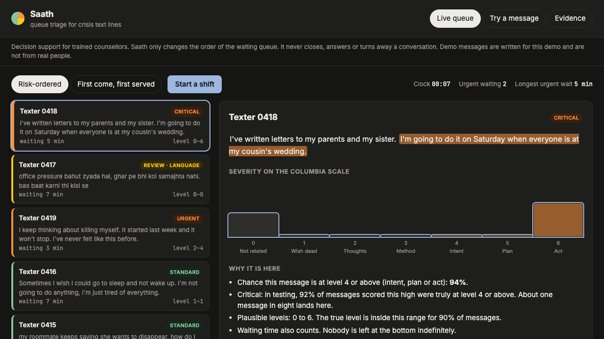
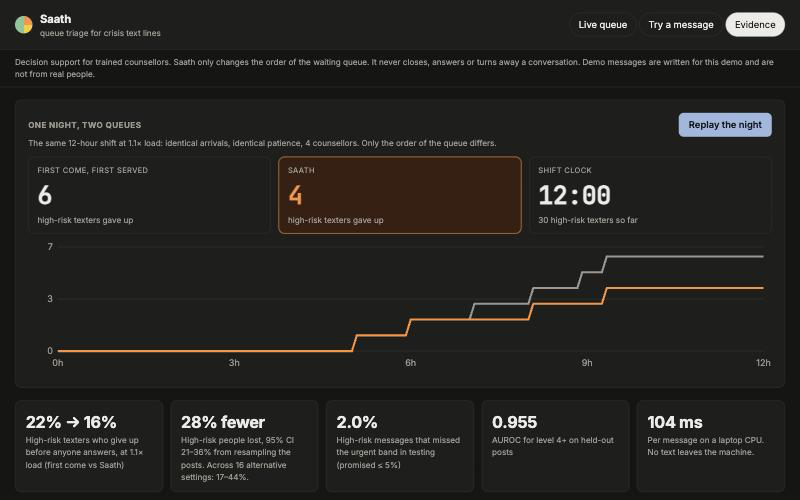

# Saath

Neural Storm 2026 · Track 3 (Human Impact) · Problem statement HI-05, Mental Health Screening & Crisis Detection

Saath sorts the waiting queue of a crisis text line by suicide risk, so the people closest to acting reach a counsellor first. It runs on an ordinary laptop CPU. A helpline can host it on its own machine, and no message is ever sent to an outside API.

- Team: Yasaswi Paruchuri (solo)
- Live demo: [huggingface.co/spaces/yasaswip012/saath](https://huggingface.co/spaces/yasaswip012/saath). The hosted page is a static copy of the console. The queue, the evidence and the night replay show responses the full model produced in advance (`scripts/build_static.py`). Text you type there is scored in your browser by the TF-IDF member of the ensemble alone (κ 0.70 against 0.81 for the full model). It highlights the sentences behind that score the same way the full model does, but gives no plausible range or band. Run it locally (below) for the full model.
- Code: [github.com/YASASWIP012/saath](https://github.com/YASASWIP012/saath)
- Demo video (92 seconds): [video/saath_demo.mp4](video/saath_demo.mp4)

To try it in a minute: open the live demo and press **Start a shift**. Click a card marked Critical to see which lines raised its score and the range of levels it could be. Then open the **Evidence** tab and press **Replay the night** to watch the same shift run in first-come order and in Saath order.





## Result

In short: in a simulated busy shift, 22% of high-risk texters give up waiting when the line answers in arrival order. With Saath ordering the queue, 15% do, close to the 14.5% that perfect knowledge of every texter's risk would give. Saath runs on a laptop CPU, and its queue result was within about a point of the ordering from frontier LLM labels (95% CI −1.5 to 1.5 points), so this test cannot tell the two apart. The catch is that all of this comes from Reddit posts and a simulated queue, not a real helpline (see [From Reddit to a real helpline](#from-reddit-to-a-real-helpline)).

We replayed a busy helpline shift 300 times. In each replay every ordering saw the same arrivals, the same conversation lengths and the same patience, so the only thing that changed was the order of the queue.

At 1.1× load, meaning 10% more conversations arrive than the counsellors can handle:

| Queue order | High-risk texters who give up before anyone answers |
|---|---|
| First come, first served | 22.0% |
| Keyword rules | 17.7% |
| Frontier LLM labels | 15.6% |
| Saath | 15.3% |
| Perfect knowledge of the true level | 14.5% |

Saath loses 31% fewer high-risk people than first-come order, which is 90% of the improvement a perfect oracle would get. At 1.5× load it is 35% fewer (35.6% to 23.3%).

The interval that matters is over posts, not over simulation runs, because only 245 of the 1,170 posts are high risk. Resampling the posts 200 times and re-running the replay on each resample gives a reduction of 28% (95% CI 21% to 35%). Saath beat first-come order in every resample and keyword rules in 96% of them (1.6 points, 95% CI −0.2 to 3.3). Against the frontier LLM ordering the difference was 0.1 points (95% CI −1.5 to 1.5), so the test cannot separate the local model from the LLM labels in either direction. These intervals hold the out-of-fold scores fixed, so they do not include the noise of retraining the model.

Low-risk texters pay for this. Their give-up rate rises from 22.3% to 24.1%, while the total share of people who give up stays at 22.3%. Saath changes who waits, and the queue as a whole is no longer than before.

The benefit does not depend on one convenient setting. We moved one assumption at a time: high-risk prevalence from 5% to 21%, high-risk texters half or twice as patient as everyone else, the aging weight from 15 minutes to none, 2 to 8 counsellors, and mean patience from 10 to 40 minutes. The reduction stayed between 17% and 45% across all 16 settings, and Saath kept 74% to 92% of the oracle's gain. It is smallest when the line is badly short-staffed (2 counsellors, 17%), when everyone is impatient (10-minute mean patience, 19%) and when waiting time is weighted heavily (15-minute aging, 21%). The full grid is in `results/queue_robustness.json`.

To compare orderings fairly, each one is converted to a percentile rank among the posts before it meets the queue. A probability, a 0 to 6 level and a yes/no label then trade off against waiting time in the same way, and the deployed console sorts by the same rule.

The Evidence tab replays one night in both orders (8 high-risk texters lost first-come, 6 with Saath, out of 29). That night is a selected example: of 100 simulated nights, it is the one whose gap is closest to the average gap.

## Problem

Crisis lines usually answer in order of arrival, and on a bad night that order has nothing to do with danger. Someone who has just swallowed pills can wait behind someone asking for clinic timings, and some of the people who wait too long close the chat. India's national tele-mental-health line, Tele-MANAS, had handled more than 18 lakh calls by early 2025 ([source](https://www.thip.media/news/tele-manas-mental-health-helpline-handles-over-18-1-lakh-calls-centre/102503/)).

Counsellors already triage by hand when they have time to skim the queue. Saath does that skim for every waiting message, continuously, and shows its reasoning.

## What a counsellor sees

The live queue reorders itself as messages arrive. Each card shows a band (critical, urgent, review or standard), the plausible severity range and how long the person has been waiting. Waiting time adds to priority, so nobody is left at the bottom indefinitely.

Opening a card shows why it sits where it does. The sentences that moved the score most are highlighted, next to the chance that the message is at level 4 or above, the distribution over all seven levels and a plain-language reason.

When the plausible range is wide, the card says so. Messages in romanised Hindi or Telugu, which the model reads poorly, are never put in the standard band.

Saath never closes, answers or turns away a conversation. It only changes the order of the list.

## How it works

```
message ─► 2 frozen sentence encoders ─┐
         └► word + character n-grams ──┼─► 6 ordinal heads ─► P(level > k), k = 0..5
                                       │
P(level ≥ 4) ─► urgent cut-off (conformal, at most 5% of high-risk missed)
level distribution ─► plausible range (conformal, 90% coverage)
sentence occlusion ─► highlighted evidence
romanised Hindi/Telugu detector ─► never "standard"
```

Data. 1,170 posts from r/SuicideWatch, labelled by human annotators on the Columbia Suicide Severity Rating Scale (C-SSRS). The scale has seven levels, from 0 (not about suicide) to 6 (a preparatory act or attempt) ([Patil et al. 2025](https://arxiv.org/abs/2505.13480), CC BY 4.0). Every post has a different author, so the five-fold split never puts one writer in both training and test. Usernames and URLs are dropped as soon as the file is read.

Model. Two frozen encoders (multilingual-e5-base and all-mpnet-base-v2) and a word and character TF-IDF each feed six logistic heads, one per threshold "level > k". The ensemble averages the three. Cumulative heads keep the scale in order: calling a level-6 post level 5 costs one threshold, and calling it level 0 costs six. The triage score, P(level ≥ 4), is one of the six outputs.

Guarantees. Both come from split conformal prediction. The deployed model is fitted on 80% of the posts and both cut-offs are set on the other 20%, which it never saw, so each guarantee holds in finite samples for new messages drawn like the calibration posts, whether or not the model is accurate. The evaluation repeats this inside every fold (fit on 75% of the training folds, calibrate on the rest, test on the held-out fold).

1. The urgent cut-off is the conformal quantile of the scores of high-risk calibration posts. A new high-risk message falls below it with probability at most 5%.
2. For the plausible range, each level k gets the score min(P(Y ≤ k), P(Y ≥ k)), and the range keeps every level above a calibrated cut-off. The kept levels always form one contiguous range, and the true level is inside it at least 90% of the time on average over messages.

Evidence. Saath removes one sentence at a time and re-scores the message. A sentence's highlight is how far the high-risk probability drops without it.

Queue replay. A discrete-event simulation with Poisson arrivals, 4 counsellors, lognormal conversation length (mean 25 minutes) and exponential patience (mean 20 minutes). Each texter is a held-out post carrying its out-of-fold score and its true level. Priority is risk plus time waited, where 45 minutes of waiting counts as much as the full risk scale.

## Results

Every number comes from nested five-fold cross-validation on posts the model did not train on: the regularisation strength is chosen by an inner 4-fold search inside each training fold, so the reported test folds played no part in choosing it. `scripts/nested.py` and `scripts/evaluate.py` regenerate all of it. Brackets are 95% bootstrap intervals.

### Severity model

| Model | Weighted κ | Recall, level 4+ | Precision, level 4+ | AUROC, level 4+ |
|---|---|---|---|---|
| Keyword rules | 0.605 [0.554, 0.651] | 0.637 | 0.632 | 0.769 |
| TF-IDF ordinal regression | 0.703 [0.659, 0.745] | 0.576 | 0.834 | 0.921 |
| Saath (local ensemble) | 0.810 [0.775, 0.842] | 0.763 | 0.817 | 0.955 [0.942, 0.967] |
| Best single frontier LLM, zero-shot | 0.878 [0.850, 0.904] | 0.922 | 0.799 | n/a |
| Median of 5 frontier LLMs, zero-shot | 0.899 [0.875, 0.919] | 0.976 | 0.701 | n/a |

The dataset authors collected the LLM labels from five large reasoning models prompted with the C-SSRS questions. Those models are better at the exact level, by 0.068 κ (95% CI 0.031 to 0.105), and we picked the "best single" one by its score on these same posts, which flatters it slightly. Among models a helpline can run on its own hardware, Saath beats TF-IDF by 0.107 κ (0.071 to 0.146). In the queue, where the ranking matters more than the exact level, the two orderings are statistically indistinguishable (see Result).

Why not just call an LLM? A crisis line's transcripts are some of the most sensitive data any service holds. Sending each one to an outside API means a data-processing agreement, a cross-border transfer review and a dependency that can rate-limit or go down on the worst night of the year. Saath gives up 0.07 κ on the exact level to avoid all of that, and loses nothing measurable in the queue.

Each encoder on its own reaches about 0.75 κ (e5 0.753, mpnet 0.746), and the ensemble adds 0.06. A third encoder, bge-base, scored 0.721 alone and was left out. Only C is nested. The choice of encoders, the TF-IDF setting and the decision to drop distillation were made by looking at the same five folds (seed 0), so treat the 0.810 as slightly optimistic. For scale, nesting C moved the estimate by 0.003.

We also tried distilling the five LLM labels into the training targets as soft labels, at weights 0.3 and 0.5. Ranking did not change (AUROC 0.956 against 0.955), and the model began over-calling high risk the way the LLMs do, so we kept the plain version.

### Guarantees on held-out folds

| | Promised | Observed |
|---|---|---|
| High-risk messages that miss the urgent band | at most 5% | 2.0% [0.4, 4.1] of 245 |
| High-risk messages that miss the critical tier | at most 50% | 49%; the tier is 11.6% of messages at 92% precision |
| True level inside the plausible range | at least 90% on average | 90.0% |
| Mean width of the range | | 2.5 levels; 32% are a single level |
| Per-level ranges (Mondrian variant): true level inside, worst level | at least 90% at every level, in expectation | 89% at level 0 (within sampling error of 351 posts); 94.1% overall |
| Mean width of the per-level ranges | | 4.7 levels |

The plain range is honest on average but uneven by level: 76%, 76% and 72% for levels 3, 4 and 5, against 90 to 94% elsewhere. Calibrating one cut-off per level fixes that, with every level at 89% or more, but the ranges grow to 4.7 of 7 levels, which tells a counsellor little. The console shows the plain range, and the per-level version is one flag away (`LevelSets(by_level=True)`).

The urgent band is wide. It holds 47% of messages, and 43% of those are truly high risk. That is the cost of promising to miss at most one high-risk person in twenty with a calibration set of about 50 high-risk posts per fold. So the band has a sharper tier inside it. A second conformal cut-off, set to catch at least half of high-risk messages, marks 11.6% of messages as critical, and 92% of those are truly at level 4 or above (it caught 51% of them in testing). A counsellor can trust a critical card on sight and still knows the wider urgent band will catch 98% of high-risk messages. The urgent band is too wide to work as a single list, so counsellors should answer critical cards first, then the rest of the urgent band.

The raw risk probability is over-confident (ECE 0.120) because the heads use balanced class weights. A cross-fitted isotonic map brings this to 0.021, and that recalibrated number is the one a counsellor sees. The ranking and both guarantees use the raw score, which an isotonic map cannot reorder.

### Stress tests

Code-mixed messages. Many Indian texters write Hindi or Telugu in Latin script, mixed with English. We wrote 56 short messages for this test, eight per severity level: 35 in Hinglish and 21 in Telugu-English (`data/stress/codemixed.csv`). They are synthetic, written with an AI assistant before any code-mixed handling existed, and no real person wrote them. The model was never trained on this kind of text, and it shows.

| On the 56 code-mixed messages | Result |
|---|---|
| Weighted κ | about 0 (−0.02) |
| AUROC, level 4+ | 0.72 (Hinglish 0.61, Telugu-English 0.93) |
| High-risk messages placed in the urgent band | 12 of 24 (50%) |
| High-risk messages kept out of the standard band, with the language check | 24 of 24 |
| Messages the language check recognised as romanised Hindi or Telugu (word list written after seeing them, so this is a development number) | 51 of 56 |
| English posts it wrongly flagged | 0 of 1,170 |

We tried to fix this with two multilingual encoders, paraphrase-multilingual-MiniLM and LaBSE, either added to the ensemble or used only for messages the detector flags. We chose on the even-numbered messages and kept the odd-numbered half aside. The best choice on the development half (MiniLM added to the ensemble, AUROC 0.68 to 0.72) did worse than the plain model on the held-out half (0.77 against 0.81), so we did not ship it (`results/codemixed_select.json`). Frozen multilingual encoders do not carry a classifier trained on English Reddit over to romanised Hindi; that needs code-mixed training data. Because of this result, the service will not put a romanised Hindi or Telugu message in the standard band; it sends those messages to review for a counsellor to read. The detector's word list was written after we saw these messages, so its 51 of 56 is optimistic. The five it missed are in `results/codemixed.json`. A real fix needs labelled code-mixed training data, which we did not have.

A different corpus. We took 1,000 posts the model had never seen from another public dataset, half from r/SuicideWatch and half from r/teenagers (Komati, Kaggle), after removing any post that also appears in our training data. Its labels only say whether a post is about suicide, so we checked P(level ≥ 1). AUROC was 0.940 [0.926, 0.954]. The high-risk score passed 0.5 for 22.2% of the SuicideWatch posts and 5.0% of the r/teenagers posts. This checks only whether the model can tell suicide-related posts from others; it says nothing about severity, because this corpus has no severity labels.

Speed. On the laptop CPU, scoring one message takes a median of 104 ms (95th percentile 146 ms), with both encoders running. The demo server runs on CPU only.

## From Reddit to a real helpline

Every number above comes from Reddit posts and a simulated queue. A helpline would replace both with its own data before Saath changes anyone's wait.

1. Shadow mode for about four weeks. Saath scores every incoming chat and reorders nothing. Counsellors keep answering in arrival order and record the C-SSRS level they judged after each chat, which gives the helpline its own labelled set.
2. Re-calibrate and check. Refit the urgent and critical cut-offs on those labels with `saath/conformal.py`, then test them on a later month they never saw. The urgent band should miss at most 5% of high-risk chats there. Then replay the helpline's own arrival and abandonment logs to confirm that fewer high-risk chats are lost than in arrival order. `saath/queue_sim.py` draws arrivals from a Poisson process today, so this step needs a small loader for real logs.
3. Go live for part of each shift. The console already has the two controls this needs: a counsellor can move any selected chat to the top, and one toggle returns the whole queue to arrival order. Code-mixed chats keep going to review until there is labelled code-mixed text to retrain on.

## Limitations and responsible use

Saath is not a diagnostic tool. The C-SSRS levels here come from annotators reading one post, not from a clinical interview. Saath orders a queue for trained counsellors and does not assess anyone.

Reddit posts are not helpline chats. They are about as long as an opening message on a text line (median 283 characters), but the tone and context differ. A helpline adopting Saath should re-calibrate both cut-offs on its own labelled transcripts, which `saath/conformal.py` is written to do.

The simulator is a model of a helpline. Arrival rate, patience and conversation length are assumptions, and any ordering that puts risk first will cut high-risk abandonment in a model where patience does not depend on risk. What the replay measures is how much of that possible gain each ordering captures, and how it holds up when the assumptions move (see the sensitivity grid). A real deployment should replay its own logs.

The 1,170 posts are resampled with replacement to fill each replay, and the pool is 21% high risk, likely far above a real helpline. The sensitivity grid includes 5% and 10% prevalence for that reason.

Code-mixed text is the weakest point, as the stress test shows. The language check is a safety net and does not fix the model.

Usernames and URLs are removed on load, the deployed model writes nothing to disk, and no third-party API is called anywhere.

If you or someone you know is struggling, in India you can call Tele-MANAS on 14416 (free, 24×7, 20 languages) or emergency services on 112.

## Run it locally

```bash
git clone https://github.com/YASASWIP012/saath && cd saath
uv sync                                               # Python 3.12
uv run python scripts/cv_predict.py keyword
uv run python scripts/cv_predict.py tfidf
uv run python scripts/nested.py                       # nested CV + split-conformal checks
uv run python scripts/queue_robustness.py             # post bootstrap + sensitivity grid
uv run python scripts/train_final.py                  # writes artifacts/
uv run python scripts/stress.py                       # code-mixed, external corpus, latency
uv run python scripts/evaluate.py                     # writes results/report.json
uv run uvicorn app.main:app --port 8000               # open http://localhost:8000
uv run pytest                                         # 16 tests
```

The dataset downloads itself from Hugging Face on the first run. On an 8 GB M1 laptop the full pipeline takes about 15 minutes, mostly spent encoding.

## Repository

```
saath/
  data.py        loading, PII removal, C-SSRS level definitions
  models.py      keyword baseline, TF-IDF and encoder ordinal heads, ensemble
  conformal.py   urgent cut-off and plausible-range sets
  queue_sim.py   discrete-event helpline replay
  evidence.py    sentence-occlusion highlights
  language.py    romanised Hindi/Telugu detector
  service.py     scoring service behind the API
app/             FastAPI server and the counsellor console (plain HTML, CSS and JS)
scripts/         cross-validation, evaluation, final training, stress tests
tests/           unit and API tests, including a check that the conformal cut-off keeps its promise
results/         report.json and every intermediate result
data/stress/     the 56 code-mixed test messages
video/           script that records the console and assembles the demo video
```

## AI tools used

The hackathon rules ask every team to disclose AI development tools. This project was built with Claude Code, an AI coding assistant, which wrote most of the code, the tests and this README under the author's direction. It also wrote the 56 code-mixed test messages and the demo queue messages. The author chose the problem, reviewed the results and made the design decisions. No AI model is called while Saath is running.

## Credits

- C-SSRS labelled posts: Patil, Tao and Gedhu, "Evaluating Reasoning LLMs for Suicide Screening with the Columbia-Suicide Severity Rating Scale", 2025, CC BY 4.0.
- External test corpus: N. Komati, "Suicide and Depression Detection", Kaggle.
- Encoders: intfloat/multilingual-e5-base and sentence-transformers/all-mpnet-base-v2.
- Video opening photo: Madison Inouye on [Pexels](https://www.pexels.com/photo/water-droplets-on-glass-window-3728298/). The video is rebuilt from the running app by `video/build.py`.
